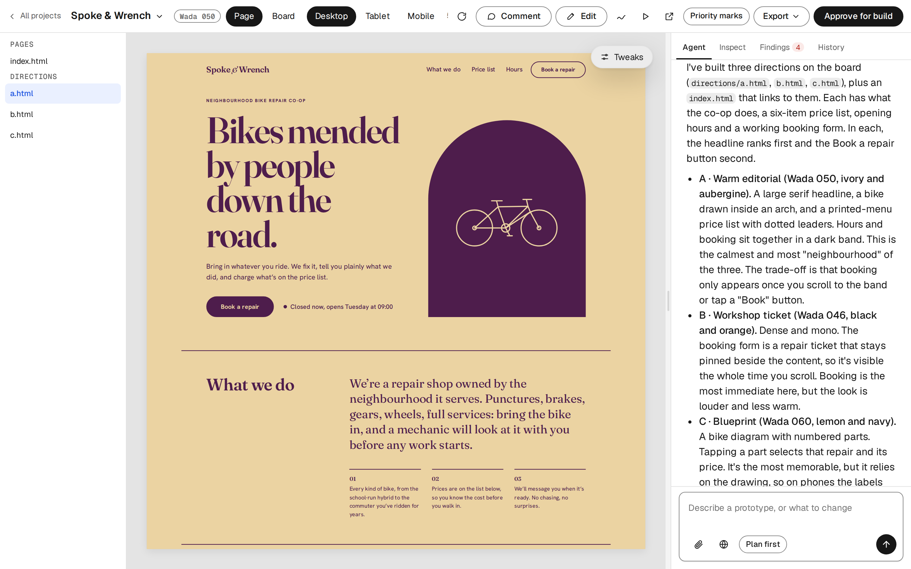
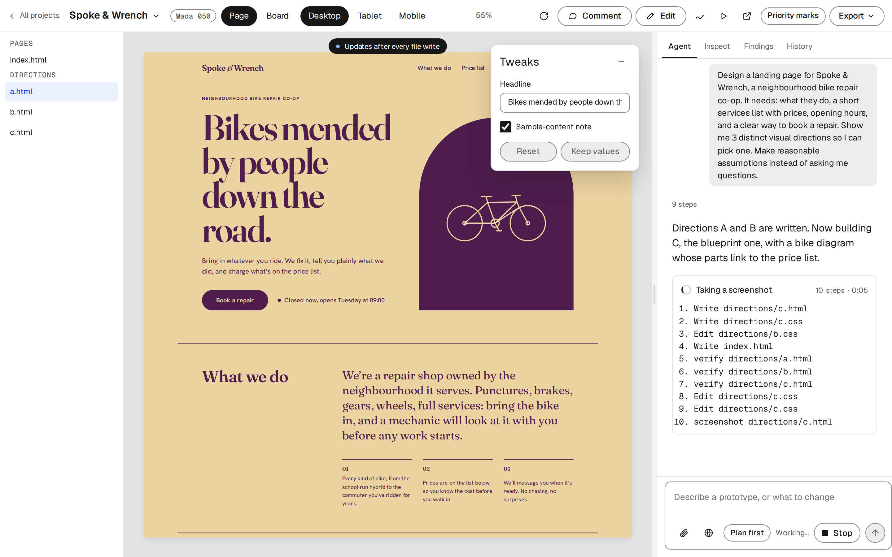
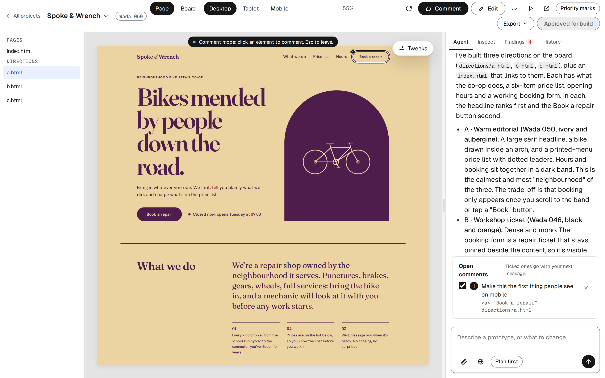
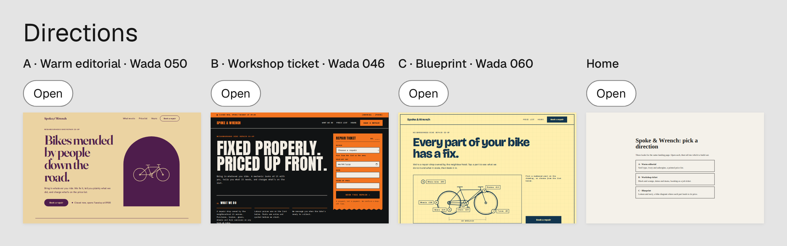
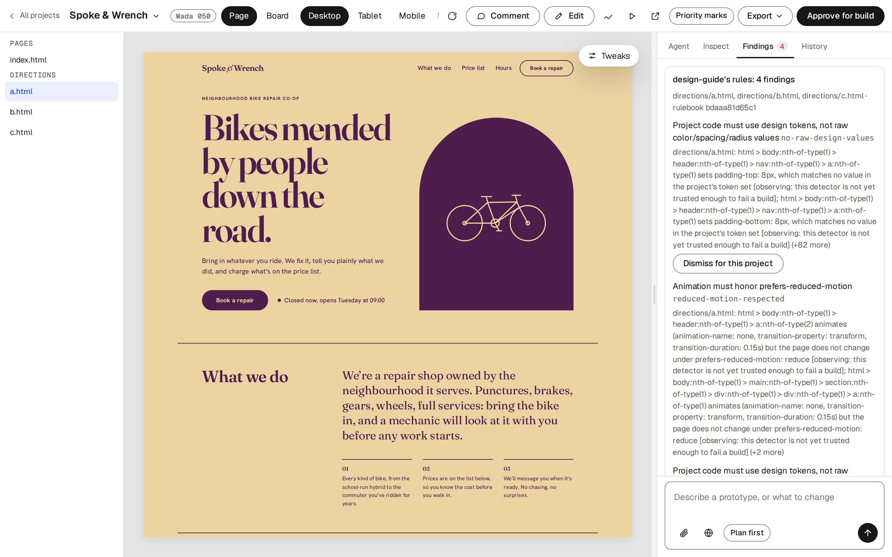
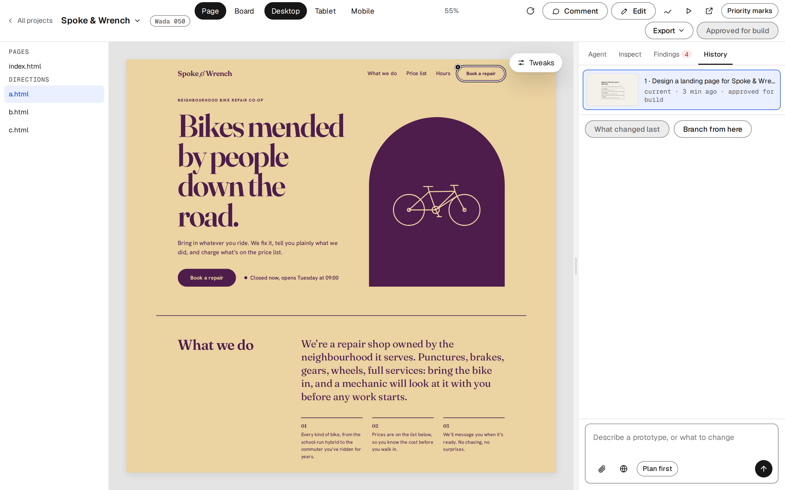

# Ultimate Design: a design studio that checks its own work

*Case study · sole author · September 2026 → ongoing · Python, FastAPI, plain JS, Playwright, Claude Code*

Describe a page in chat. A design agent writes it as real HTML, CSS and JS, renders it,
checks it, and the canvas shows it live. You refine it by commenting on elements, editing in
place and dragging sliders the agent generated, and every turn is saved as a version you can
compare and restore. When you approve a design, Claude Code builds it in your codebase.

It is a local rebuild of Anthropic's Claude Design, with one difference that shaped most of
the work: **the rules a design has to meet are checks the agent cannot finish without
passing, not instructions it is asked to follow.**

| | |
|---|---|
| Role | sole author: product, design, engineering |
| Timeline | first decision 2026-09-18; public 2026-10-13; ongoing |
| Stack | Python 3.11, FastAPI, plain JS with no build step, Playwright, headless Claude Code (`claude -p`), MCP |
| Size | about 5,000 lines of Python, 5,600 of front end, 411 tests, 79 recorded decisions |
| Source | [github.com/rexoriousyun/ultimate-design](https://github.com/rexoriousyun/ultimate-design) (MIT) |

## 1. Why build it

Claude Design is good at the first draft and weak at the things I care about most:

- **It runs in the cloud, on its rules.** I wanted it on my machine, on my own Claude
  subscription, with my own design systems and my own rule book.
- **Nothing makes a design read in order of importance.** Every AI design tool I tried in
  September 2026 either gives the model rules as context (Figma Make guidelines, Stitch's
  DESIGN.md, Claude Code skills), constrains it with pre-built parts (v0, Relume), or
  critiques afterwards (heatmaps, voice critique). None of them checks hierarchy *inside*
  the generation loop, while the agent can still fix it.
- **Comments get lost.** A note pinned to an element should stay open until it is dealt
  with, not disappear when the next message is sent.

So the project had two goals: rebuild the workflow locally, and make the design agent prove
its work before it hands it over.

## 2. The loop

The studio is chat on the right and a live canvas in the middle. The design agent is
headless Claude Code, run in the design's folder with its own system prompt, written from
scratch for this project. It brings the agent loop, file tools and session resume, so the
app doesn't reimplement any of them; the app supplies the canvas, the history and the
checks.

- **The canvas** is a sandboxed iframe that reloads after every file write. It can't reach
  the studio's API or DOM. Comments, tweaks and options work through a small bridge script
  that is injected only into the canvas, so the design's own files and exports stay clean.
- **Every message is a version.** Each turn is one commit in a git repository kept outside
  the design folder, so the agent never sees `.git`. Restoring a version is a new commit,
  so nothing is ever lost. History shows a thumbnail per version, and Compare outlines what
  changed between two of them.
- **Turns run in the background.** Closing or reloading the tab used to kill the agent
  mid-work; now a reloaded page reattaches to the running turn, and only the Stop button
  stops it.
- **The agent is isolated from my own setup.** My global CLAUDE.md, hooks, plugins and MCP
  servers are switched off for the design agent (`--setting-sources ""`,
  `--strict-mcp-config`). Before that it inherited unrelated instructions.

## 3. Refining without spending the model

A model call is slow and costs money. Most refinement shouldn't need one.

- **Comments** store the element's selector, tag and text. Open comments go with the next
  message, and the agent marks each one resolved through a tool. Unresolved comments are
  sent again, so none are silently dropped.
- **Tweaks.** The agent declares a few high-impact values in a JSON block on the page
  (colours, sizes, copy, toggles). The studio renders controls for them (the Tweaks panel
  in the screenshot in section 2), and changes apply live through CSS custom properties,
  with no model call. "Keep values" writes them back as the new defaults and makes a
  version.
- **Direct edits.** Text that occurs once in the files is changed in place; style edits go
  into one overrides stylesheet per page. Anything that can't be placed safely goes to the
  agent.

## 4. Directions, side by side

Ask for options and the agent writes each direction as its own page. The board lays them out
in rows at their real sizes, so they can be compared at a glance. Keeping one is a chat
message: the agent removes the rest with full context, because cutting a layout apart by
string surgery breaks it. "Try something completely different" makes a branch, a new
project from one version's files, so the original keeps its history.

## 5. Rules as checks, not prompts

This is the part of the project I'd point to first.

Again and again, telling the agent a rule was not enough:

- A local model shipped a page without its stylesheet. Grove designs failed contrast. No
  error was raised in either case.
- In a live run, Haiku loaded the design system's `components.css` and then styled its own
  `.invoice-card` anyway.
- Both agents kept writing Markdown in chat despite prompts saying not to.

Each time, the fix was the same: turn the rule into a check. The design agent has a
`verify` tool (an MCP server running Playwright) that renders the page at desktop and mobile
widths and reports:

- **console errors and files that failed to load**, including errors the agent didn't write
  (it fixes them with the smallest change and says so);
- **contrast** and **target size**, the accessibility floor, which block;
- **hierarchy**: the agent marks the intended reading order with `data-priority`, and
  `verify` compares it with a prominence score computed from the rendered styles (size,
  weight, colour, position). It fails until they agree, and each finding says what to
  change. I chose a heuristic with visible parts over a saliency model so that a finding
  is something you can act on;
- **design-system conformance**: any colour or font outside the attached system fails.
  Deliberate exceptions are declared as `--ds-override-*` properties, so they're visible in
  the code. An element styled like a system component without being one fails too. After
  that check, the same Haiku run switched to `ds-card` in one turn.

If a turn wrote files without calling `verify`, the server nudges the agent once. (Once, to
bound the cost.) Prompts alone weren't reliable; the check is.

## 6. A rule book that learns

The checks above are built in. A workspace can instead use
[design-guide](https://rexoriousyun.github.io/#/work/design-guide) as its rule book: my own design substrate,
with accessibility invariants, preferences I've taken a stance on, and a gate that fails a
built page against them. `verify` reads that rule book, and the studio's Findings tab shows
what it found.

Every choice made in the studio is logged as a decision: picking a direction, keeping tweak
values, a direct edit, restoring an old version, dismissing a finding. Each can carry a
reason. design-guide reads those logs across projects and proposes new rules when the same
choice keeps coming up. A rule only becomes one when I confirm it, with a reason. The tool
learns my taste from what I do, not from adjectives I'd have to write down.

## 7. Into the codebase: Claude Code

The repo is also a Claude Code plugin. From a terminal session, Claude can create a design in
the studio, send it messages, and then wait. I review it in the studio, and when it's right I
press **Approve for build**. Claude Code then reads the approved version and its handoff
notes (screens, tokens, components, hierarchy) and implements exactly that. The MCP server
holds no state of its own: it drives the running app over HTTP, so the terminal and the studio
always see the same projects, turns and versions.

It can also build a design system from the codebase you're in, and connect your own MCP
servers to the design agent for context, per project and only when you opt in.

## 8. How it's built

- **No API key.** The agent runs on the logged-in Claude Code account, so it uses my
  subscription. Local models run through the same harness via Ollama's Anthropic-compatible
  API; an 8B Qwen model went from 0 of 7 working pages to 2 of 3 after three small fixes
  (text-only previews, a proxy that turns thinking off, and an empty-turn retry).
- **Models switch per project.** Between Claude models the conversation continues; to or
  from a local model, a new session starts and the agent is told to read the files first.
- **Tests never call a model.** 411 tests run against a fake engine and a fake CLI, including
  Playwright tests of the studio itself. A live run only happens in the manual end-to-end
  check.
- **The docs are tested too.** A test fails when an HTTP route, stream event, module, MCP
  tool, CLI flag or test file is missing from the docs, so the docs can't drift from the
  code.
- **Decisions are written down.** 79 dated entries in `docs/decisions.md` say what was
  chosen and why, so a later change, mine or an agent's, doesn't undo a choice without
  knowing the reason.
- **Personal data stays out of the repo.** Designs, chats and settings live in a workspace
  folder. A company can keep one in a private repository, with its design systems and
  written guides, and each person points the app at their clone.

It ships with [creative-library](../creative-library/README.md), my library of verified visual
techniques (grain, halftone, flow fields, glitch, charts, three.js scenes), which the design
agent searches and copies from, and with Sanzo Wada's 348 colour combinations for designs
without a design system.

## 9. What I learned

- **An agent follows a check more reliably than an instruction.** The most useful work was
  finding the rules the agent kept breaking and making each one something `verify` measures.
- **Hierarchy can be measured well enough to act on.** A heuristic with visible parts beats
  a model's opinion, because every finding says what to change.
- **Keep the model out of the cheap paths.** Tweaks, comments, restores and most edits cost
  nothing, so the model is spent where judgment is needed.

## Known limits

- The built-in rule book measures only the in-page floor (contrast, target size, reflow).
  Written guides are read by the agent, not measured.
- Recipes are copied into designs, so a later fix to a recipe doesn't reach designs that
  already copied it.
- Direct text edits are placed automatically only when the text occurs once in the files.

---

*Ultimate Design is an independent project, not affiliated with or endorsed by Anthropic.
The screenshots show a demo design, Spoke & Wrench, made in one turn by the design agent on
Claude Sonnet 5.5.*
